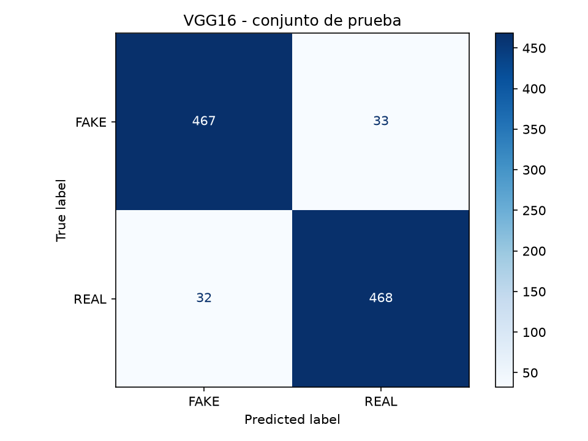
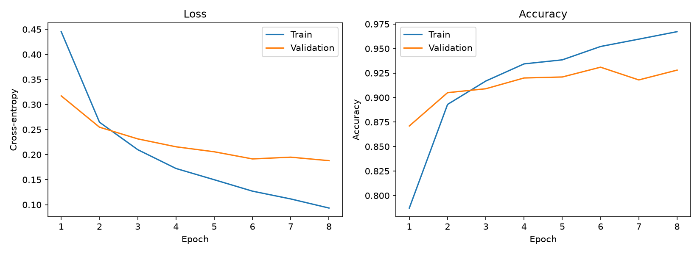

# VGG16 AI-Generated Image Classification

This project fine-tunes an ImageNet-pretrained VGG16 model to classify images
as `REAL` or `FAKE` using a balanced 10,000-image sample of CIFAKE. The reported
test metrics describe a held-out split from CIFAKE only; they do **not** show
that the model can reliably determine whether arbitrary images from the
internet are authentic.

> [!WARNING]
> This model has produced confident false `FAKE` predictions on real photos
> from outside CIFAKE. Its softmax score is not a calibrated probability of
> authenticity. Do not use this project to verify real-world images.

## Test-set results

The selected checkpoint, `vgg16_cifake_finetune_block5_8ep.pth`, was evaluated
on 1,000 held-out images (500 per class). It achieved 93.50% accuracy and
93.50% macro F1 on this CIFAKE split.

| True class | Predicted FAKE | Predicted REAL |
|---|---:|---:|
| FAKE | 467 | 33 |
| REAL | 32 | 468 |

Rows show the true class and columns show the predicted class. In this test
split, 32 of the 500 REAL images were classified as FAKE. Performance on
external images can be much worse.



The chart below shows the training and validation history for the fine-tuning
run. The best validation accuracy was 93.10% at epoch 6; the checkpoint was
selected using validation, before the one-time test evaluation.



## Dataset and splits

The dataset source is
[CIFAKE on Hugging Face](https://huggingface.co/datasets/yanbax/CIFAKE_autotrain_compatible).
The local preparation script samples 5,000 images from each class with seed 42
and copies them into these splits:

| Split | REAL | FAKE | Total | Purpose |
|---|---:|---:|---:|---|
| Train | 4,000 | 4,000 | 8,000 | Fit model parameters |
| Validation | 500 | 500 | 1,000 | Compare training runs and select a checkpoint |
| Test | 500 | 500 | 1,000 | Final evaluation after model selection |

The local test split is sampled from the available CIFAKE training data; it is
not CIFAKE's original official test split. CIFAKE's real images come from
CIFAR-10 and its synthetic images were generated with Stable Diffusion v1.4.
This limited source coverage is one reason results should not be generalized
to arbitrary real and AI-generated images.

## Project structure

```text
vgg16-ai-image-detection/
├── data/
│   ├── raw/                 # Dataset source notes; source data stays outside Git
│   └── processed/           # Local train/val/test image folders
├── docs/
│   └── figures/             # Figures embedded in this README
├── app/
│   ├── index.html           # Local image-classification interface
│   └── server.py            # FastAPI web app and prediction API
├── models/                  # Local model checkpoints (not tracked)
├── results/                 # Local metrics and generated plots (not tracked)
├── prepare_dataset.py
├── train.py
├── evaluate.py
├── predict.py
├── model_utils.py
├── requirements.txt
└── README.md
```

## Setup

Use Python and a PyTorch build compatible with your hardware. On Windows
PowerShell, activate the project's virtual environment and install the
requirements:

```powershell
.\.venv\Scripts\Activate.ps1
python -m pip install -r requirements.txt
```

The default dataset source path is
`C:\Users\USUARIO\Downloads\train`, containing `real/` and `fake/` folders.
Prepare the sample:

```powershell
python prepare_dataset.py
```

To use a different source directory:

```powershell
python prepare_dataset.py --source-dir "D:\datasets\CIFAKE\train"
```

The script does not modify the source dataset and refuses to overwrite an
existing `data/processed/` directory. Move or rename that directory before
preparing a new sample.

## Train, evaluate, and predict

### Start the web interface

Start the FastAPI server from the project root:

```powershell
python -m app.server
```

Then open [http://127.0.0.1:8000](http://127.0.0.1:8000) in your browser. The
server hosts both the interface and the `/api/models` and `/api/predict` API
routes. Do not use VS Code Live Server's `:5500` URL as the API server; the
interface is configured to send its API requests to port `8000` when opened
from another origin.

Keep the terminal running while using the web interface. Press `Ctrl+C` to
stop the server.

### Train and evaluate from the terminal

Run the default head-only training configuration:

```powershell
python train.py --device cuda
```

The fine-tuning run documented in this repository can be reproduced with:

```powershell
python train.py --device cuda --strategy finetune-last-block `
  --epochs 8 --batch-size 16 --learning-rate 1e-4 `
  --backbone-learning-rate 1e-5 --seed 42 `
  --run-name vgg16_cifake_finetune_block5_8ep
```

## Live

Test app live:

```powershell
python -m app.server
```

### Input image size

You do **not** need to resize prediction images to 32 × 32 yourself. The
32 × 32 size describes the CIFAKE images used for training. Before inference,
`predict.py` applies the Torchvision ImageNet preprocessing transform: it
resizes the image and takes a 224 × 224 center crop, then normalizes it. Larger
images can therefore be loaded and classified; they are not passed to the
network at their original dimensions. For a 32 × 32 CIFAKE image, this
preprocessing enlarges the image, but it cannot restore detail that was not
present in the original.

Evaluate the selected checkpoint on the held-out local test split:

```powershell
python evaluate.py --device cuda `
  --checkpoint models\vgg16_cifake_finetune_block5_8ep.pth
```

Try a prediction on one image:

```powershell
python predict.py "C:\path\to\image.jpg" --device cuda `
  --checkpoint models\vgg16_cifake_finetune_block5_8ep.pth
```

`predict.py` prints the predicted class and the model's softmax score. That
score is not a calibrated probability, and a high score does not guarantee a
correct prediction—especially for images outside CIFAKE.

## Generated outputs

- `models/*.pth`: trained model checkpoints.
- `results/training_history*.csv`: per-epoch training and validation metrics.
- `results/loss_accuracy*.png`: training and validation curves.
- `results/metrics_report.json`: per-class test metrics and confusion matrix.
- `results/confusion_matrix.png`: test-set confusion matrix.

Local data, checkpoints, and generated results are excluded from Git. The
figures under `docs/figures/` are committed copies used by this README.
