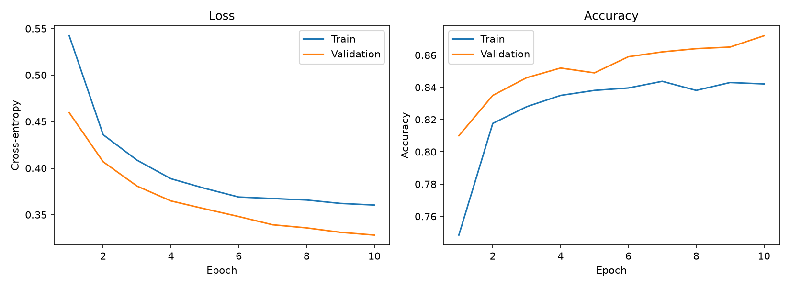
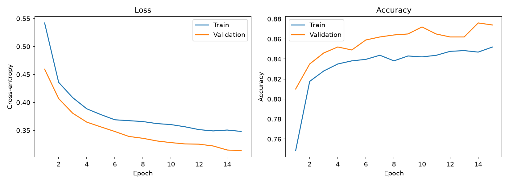

# Clasificación de imágenes reales y generadas por IA con VGG16

**Informe técnico del proyecto CIFAKE**

Este informe documenta el origen de los datos, la configuración del entorno y
las tres estrategias de entrenamiento probadas con VGG16. Incluye las métricas
de entrenamiento y validación de cada corrida; la evaluación final del
conjunto de prueba permanece deliberadamente en blanco.

> **Estado del estudio:** experimentos 1, 2 y 3 completados y checkpoint final
> evaluado una vez sobre la partición retenida `test`. La evaluación alcanzó
> 93,50 % de accuracy; el resultado corresponde a CIFAKE y no demuestra
> generalización a imágenes de otros dominios.

## Carátula

| Campo | Información |
|---|---|
| Institución | `[Nombre de la institución]` |
| Facultad / programa | `[Facultad o programa académico]` |
| Asignatura | `[Nombre de la asignatura]` |
| Título | Clasificación de imágenes reales y generadas por IA con VGG16 |
| Autor(es) | `[Nombre(s) del/de los estudiante(s)]` |
| Docente | `[Nombre del/de la docente]` |
| Ciudad | `[Ciudad]` |
| Fecha de entrega | `[Día, mes y año]` |

## Índice

1. [Introducción](#1-introducción)
2. [Objetivo](#2-objetivo)
   1. [General](#21-general)
   2. [Específicos](#22-específicos)
3. [Fundamentos teóricos](#3-fundamentos-teóricos)
4. [Comparación con otras arquitecturas](#4-comparación-con-otras-arquitecturas)
5. [Caso práctico](#5-caso-práctico)
   1. [Dataset](#51-dataset)
   2. [Herramientas utilizadas](#52-herramientas-utilizadas)
   3. [Preparación de los datos](#53-preparación-de-los-datos)
   4. [Implementación del modelo](#54-implementación-del-modelo)
   5. [Entrenamiento](#55-entrenamiento)
   6. [Resultados](#56-resultados)
   7. [Análisis de resultados](#57-análisis-de-resultados)
6. [Ventajas y limitaciones](#6-ventajas-y-limitaciones)
7. [Conclusiones y recomendaciones](#7-conclusiones-y-recomendaciones)
8. [Bibliografía (APA)](#8-bibliografía-apa)

## 1. Introducción

Los sistemas generativos pueden crear imágenes de apariencia realista, lo que
complica distinguir imágenes sintéticas de imágenes procedentes de fotografías
reales. Una red neuronal convolucional puede aprender patrones visuales que
ayuden a clasificar ejemplos, pero el desempeño medido en un conjunto de datos
no garantiza que el detector funcione igual de bien ante otros generadores,
calidades, formatos o dominios.

Este proyecto estudia una clasificación binaria con VGG16 y CIFAKE. La fuente
contiene imágenes reales y sintéticas; para que el experimento sea manejable,
reproducible y balanceado se seleccionan 10 000 imágenes y se separan en
entrenamiento, validación y prueba. La primera estrategia congela las capas
convolucionales preentrenadas en ImageNet y entrena una nueva cabeza
clasificadora.

El informe diferencia entre **resultados de validación**, usados para observar
el aprendizaje y seleccionar un checkpoint, y **resultados de prueba**, que
deben calcularse una sola vez después de cerrar las decisiones del modelo. La
exactitud de validación de la primera corrida es 87,20 % en la época 10; esta
cifra no debe interpretarse como exactitud de prueba ni como una medida
universal para detectar cualquier imagen generada por IA.

## 2. Objetivo

### 2.1. General

Implementar y estudiar un clasificador basado en VGG16 para distinguir las
clases REAL y FAKE del conjunto CIFAKE mediante transferencia de aprendizaje y
una evaluación experimental separada por particiones.

### 2.2. Específicos

- Seleccionar de forma reproducible 5 000 imágenes de cada clase.
- Crear particiones balanceadas de entrenamiento, validación y prueba en
  proporción 80/10/10.
- Entrenar una cabeza binaria sobre las características congeladas de VGG16.
- Usar la validación para seguir el aprendizaje y elegir el mejor checkpoint,
  manteniendo test fuera del ciclo de ajuste.
- Comparar las estrategias ensayadas y documentar qué parámetros cambian en
  cada corrida, distinguiendo los cambios aislados de las configuraciones que
  modifican más de un factor.
- Reportar métricas por clase, matriz de confusión, configuración de hardware
  y limitaciones de generalización.

## 3. Fundamentos teóricos

### 3.1. Clasificación de imágenes y CNN

Una imagen puede representarse como un arreglo de píxeles y canales de color.
Una red neuronal convolucional (CNN) aplica filtros compartidos sobre regiones
locales para aprender patrones espaciales. Las capas iniciales suelen
responder a bordes, colores y texturas; las capas más profundas combinan esas
respuestas en representaciones de mayor nivel. Las capas de *pooling* reducen
la dimensión espacial de las activaciones.

En clasificación supervisada, cada imagen se asocia con una etiqueta conocida.
El modelo genera puntuaciones para las clases y sus parámetros se optimizan
para reducir una función de pérdida sobre los ejemplos etiquetados.

### 3.2. Arquitectura VGG16

VGG16 es una arquitectura convolucional profunda presentada por Simonyan y
Zisserman. Su configuración clásica organiza 13 capas convolucionales en
bloques y tres capas totalmente conectadas. Emplea filtros de 3 × 3, ReLU y
*max pooling*. La estructura secuencial hace que el flujo de procesamiento sea
relativamente fácil de describir y visualizar.

La implementación de este proyecto parte de VGG16 de Torchvision con pesos
`IMAGENET1K_V1`. Para adaptar la salida al problema binario, se sustituyen el
*pooling* espacial final por `AdaptiveAvgPool2d((1, 1))` y el clasificador
original por *dropout* de 0,3 seguido de una capa lineal de 512 características
a dos logits: FAKE y REAL.

### 3.3. Transferencia de aprendizaje

La transferencia de aprendizaje reutiliza representaciones aprendidas en una
tarea con muchos datos para iniciar otra tarea relacionada. En el primer
experimento se congelan todos los parámetros convolucionales de VGG16 y solo
se actualiza la cabeza clasificadora. Esto:

- reduce la cantidad de parámetros que se entrenan;
- disminuye el costo frente a ajustar toda la red;
- proporciona una línea base antes de probar el ajuste fino;
- reduce, aunque no elimina, el riesgo de sobreajustar una muestra limitada.

Una segunda estrategia razonable es descongelar el último bloque convolucional
y ajustarlo con una tasa de aprendizaje pequeña. Es una hipótesis de mejora,
no un resultado anticipado: sus métricas se deben medir con el mismo conjunto
de datos y el mismo protocolo.

### 3.4. Pérdida y métricas

La pérdida usada es entropía cruzada multiclase (`CrossEntropyLoss`) sobre los
dos logits. El optimizador es AdamW. La exactitud se calcula como la proporción
de etiquetas correctamente clasificadas.

En la evaluación final se reportarán además:

- **Precisión por clase:** de las predicciones de una clase, qué proporción
  corresponde realmente a ella.
- **Recall por clase:** de los ejemplos reales de una clase, qué proporción
  recupera el modelo.
- **F1 por clase:** media armónica de precisión y recall.
- **Promedio macro:** promedio no ponderado de la métrica de las dos clases.
- **Matriz de confusión:** conteo de predicciones frente a etiquetas reales;
  permite distinguir los falsos positivos de los falsos negativos.

La exactitud sola puede ocultar errores asimétricos, por lo que no será la única
métrica de la evaluación de prueba.

## 4. Comparación con otras arquitecturas

La siguiente comparación es **teórica y cualitativa**; no se han entrenado
estos modelos en este proyecto. Se incluyen arquitecturas representativas para
dar contexto a VGG16 y porque ilustran compromisos diferentes de profundidad,
eficiencia y complejidad.

| Arquitectura | Idea principal | Razón para compararla | Consideración en este proyecto |
|---|---|---|---|
| **VGG16** | Bloques secuenciales de convoluciones 3 × 3 | Es el modelo requerido y una referencia didáctica clara para transferencia de aprendizaje | Consume más cómputo que arquitecturas modernas eficientes |
| **ResNet** | Conexiones residuales que facilitan el flujo de gradientes | Representa una alternativa profunda ampliamente usada y permite estudiar el efecto de conexiones *skip* | Añade una estructura más compleja que la secuencia de VGG |
| **MobileNet** | Convoluciones separables para reducir costo | Permite contrastar con un diseño orientado a dispositivos con recursos limitados | Busca eficiencia y no necesariamente iguala el objetivo pedagógico de VGG16 |
| **EfficientNet** | Escalado coordinado de resolución, profundidad y anchura | Ilustra una familia moderna que busca equilibrar tamaño y capacidad | Requiere escoger una variante y controlar también la resolución |

Una comparación experimental válida debe entrenar cada arquitectura con la
misma división de datos, preprocesamiento comparable, criterio de selección,
presupuesto de ajuste y conjunto de prueba. Hasta que se realice ese
experimento, no se atribuye superioridad cuantitativa a ninguna arquitectura.

## 5. Caso práctico

### 5.1. Dataset

#### Repositorio y organización

El código del proyecto está en el repositorio:
[github.com/CristianOlivera1/vgg16-ai-image-detection](https://github.com/CristianOlivera1/vgg16-ai-image-detection).

| Ruta | Responsabilidad |
|---|---|
| `prepare_dataset.py` | Selecciona, balancea y separa imágenes del origen local |
| `data/processed/` | Particiones de imágenes organizadas para `ImageFolder` |
| `model_utils.py` | Constructor de VGG16, clases, dispositivo y checkpoints |
| `train.py` | Entrenamiento y validación; guarda el mejor checkpoint y curvas |
| `evaluate.py` | Evaluación final en `test`, reporte JSON y matriz de confusión |
| `predict.py` | Predicción individual con un checkpoint existente |
| `models/` | Checkpoints locales; no son resultados de prueba |
| `results/` | Historiales y gráficas generados por las ejecuciones |
| `docs/figures/` | Imagen de la primera corrida incluida en este informe |

Las imágenes del dataset y los pesos del modelo no se deben incluir en Git.
El repositorio contiene código y documentación; el dataset se obtiene y se
mantiene localmente.

#### Dataset y procedencia

La fuente de datos es
[CIFAKE en Hugging Face](https://huggingface.co/datasets/yanbax/CIFAKE_autotrain_compatible).
La ficha del dataset describe 50 000 imágenes REAL y 50 000 FAKE. Las imágenes
reales provienen de CIFAR-10 y las imágenes sintéticas fueron creadas con
Stable Diffusion v1.4. La copia alojada en Hugging Face elimina de la
distribución las imágenes de los splits de prueba originales, conservando las
imágenes de entrenamiento del dataset original.

En este entorno, la copia local examinada está en
`C:\Users\USUARIO\Downloads\train`, con 50 000 JPG directamente en cada una de
las carpetas `real/` y `fake/`. Una imagen inspeccionada por clase mide 32 × 32
píxeles, está en modo RGB y es JPEG.

La ficha de Hugging Face enlaza el trabajo de Bird y Lotfi (2023) y declara la
licencia MIT para la copia del conjunto, con atribución a CIFAR-10 y a los
autores de CIFAKE. Consultar la ficha y conservar las citas pertinentes si se
redistribuyen los datos o se publica el trabajo.

### 5.2. Herramientas utilizadas

| Componente | Configuración observada |
|---|---|
| Sistema de ejecución | Windows, PowerShell y entorno virtual `.venv` |
| Python | 3.13.14 |
| PyTorch | 2.11.0+cu128 |
| Torchvision | 0.26.0+cu128 |
| Runtime CUDA de PyTorch | 12.8 |
| cuDNN | 91900 |
| GPU | NVIDIA GeForce RTX 3050 6GB Laptop GPU |
| Memoria GPU detectada | 6,0 GiB |
| Pillow | 13.0.0 |
| scikit-learn | 1.9.1 |
| Matplotlib | 3.11.2 |
| tqdm | 4.70.1 |

Las versiones de PyTorch y Torchvision anteriores corresponden al entorno
virtual revisado. Para una reproducción estricta, guardar también la salida
de `python -m pip freeze` del mismo entorno con el que se ejecute cada
experimento.

### 5.3. Preparación de los datos

El preparador toma una muestra aleatoria sin reemplazo de 5 000 archivos por
clase usando la semilla 42. A continuación mezcla cada lista y copia los
archivos a `data/processed/`; no mueve, modifica ni incorpora la fuente al
repositorio. El orden alfabético inicial de los nombres y el muestreo con
semilla fija permiten repetir la selección mientras la fuente no cambie.

#### Justificación de la proporción 80/10/10

La asignación 80/10/10 es una decisión práctica para este experimento, no una
regla universal:

1. **Entrenamiento (80 %, 8 000 imágenes):** conserva la mayor parte de la
   muestra para ajustar la cabeza del modelo.
2. **Validación (10 %, 1 000 imágenes):** ofrece ejemplos de ambas clases para
   observar la evolución entre épocas y seleccionar el checkpoint, sin usar
   las etiquetas de test para ajustar el modelo.
3. **Prueba (10 %, 1 000 imágenes):** mantiene una partición independiente
   para la evaluación final después de congelar las decisiones de diseño.

Al balancear las clases dentro de cada partición, accuracy tiene una
interpretación inicial más directa y ambas clases tienen representación
suficiente para métricas por clase. Una partición mayor de test aumentaría el
número de ejemplos para evaluación a costa del entrenamiento; una validación
muy pequeña haría más variable la selección del checkpoint.

| Partición | REAL | FAKE | Total | Uso permitido |
|---|---:|---:|---:|---|
| `train` | 4 000 | 4 000 | 8 000 | Ajustar parámetros |
| `val` | 500 | 500 | 1 000 | Comparar épocas/configuraciones y elegir checkpoint |
| `test` | 500 | 500 | 1 000 | Una evaluación final después de cerrar los experimentos |
| **Total** | **5 000** | **5 000** | **10 000** | |

El directorio de test creado aquí es una partición nueva extraída del contenido
local de `train`; **no es el test oficial original de CIFAKE**. Debido a que la
copia de Hugging Face ya excluyó los ejemplos del test original, esta
evaluación permite estimar el rendimiento en imágenes retenidas de la misma
distribución de entrenamiento, pero no demuestra generalización a imágenes
independientes de otros generadores o fuentes.

### 5.4. Implementación del modelo

| Decisión | Configuración de la corrida base |
|---|---|
| Arquitectura | VGG16 de Torchvision |
| Pesos iniciales | `IMAGENET1K_V1` |
| Backbone | Capas convolucionales congeladas |
| Cabeza | `AdaptiveAvgPool2d((1, 1))`, `Dropout(0.3)`, `Linear(512, 2)` |
| Orden de etiquetas | `FAKE = 0`, `REAL = 1` |
| Transformación | Preprocesamiento del preset de pesos de Torchvision |
| Entrada al modelo | Redimensionamiento a 256 y recorte central a 224 × 224 |
| Normalización | Media y desviación estándar de ImageNet definidas por el preset |
| Función de pérdida | Entropía cruzada |
| Optimizador | AdamW |
| Tasa de aprendizaje | 0.001 |
| Selección de checkpoint | Mayor accuracy de validación |
| Planificador de tasa | No configurado en esta versión |
| Parada temprana | No configurada; se completan las épocas solicitadas |

Los parámetros congelados no reciben gradientes. El entrenamiento actualiza
solamente los pesos y sesgos de la capa lineal de la cabeza. Aunque VGG16
preentrenada fue diseñada para imágenes de mayor resolución, los JPG de CIFAKE
son de 32 × 32; el redimensionamiento a 224 × 224 es necesario para el preset
de ImageNet, pero no recupera detalle que no estaba en la imagen original.

### 5.5. Entrenamiento

#### Configuración y uso de la GPU

Se activó el entorno virtual y se indicó CUDA explícitamente:

```powershell
.\.venv\Scripts\Activate.ps1
python train.py --device cuda
```

`--device cuda` pide ejecutar el modelo y los lotes en CUDA; el programa falla
si CUDA no está disponible, en vez de fingir una ejecución en GPU. Para la
corrida registrada, la consola imprimió `Dispositivo: cuda`, y el hardware
reportado fue la NVIDIA GeForce RTX 3050 Laptop GPU con 6 GB de VRAM. PyTorch
detectó el runtime CUDA 12.8 y cuDNN 91900 en la inspección del entorno.

La semilla predeterminada es 42. El script inicializa los generadores de
PyTorch y CUDA, habilita determinismo de cuDNN y deshabilita
`cudnn.benchmark`. Los lotes se transfieren al dispositivo; en CUDA el
`DataLoader` utiliza `pin_memory=True`. El tamaño de lote predeterminado es 32
y el número de workers es 0. No se habilitó entrenamiento de precisión mixta
(AMP) en la corrida base.

La misma corrida también puede iniciarse de forma reproducible explícita con:

```powershell
python train.py --device cuda --epochs 10 --batch-size 32 `
  --learning-rate 0.001 --workers 0 --seed 42
```

#### Diseño de experimentos

El plan compara estrategias para entender qué aporta cada cambio. La corrida
de 10 épocas es la línea base. Una repetición con 15 épocas probó si prolongar
el mismo entrenamiento aportaba mejoras; el ajuste fino del último bloque
prueba ahora si actualizar características convolucionales más específicas
ayuda a esta tarea. En cada comparación se mantienen iguales los datos, las
transformaciones y la semilla; el experimento 3 cambia la estrategia de ajuste,
la tasa de aprendizaje por grupo y el tamaño de lote, por lo que sus resultados
se interpretan como comparación de esa estrategia conjunta y no como efecto
aislado de una sola variable.

| Experimento | Estrategia | Cambio respecto a la línea base | Estado |
|---|---|---|---|
| 1 | VGG16 congelada, 10 épocas | Línea base; clasificador lineal nuevo | **Completado** |
| 2 | VGG16 congelada, 15 épocas | Cambiar solo el número total de épocas; iniciar una nueva corrida | **Completado** |
| 3 | Ajuste fino del último bloque VGG16 | Descongelar el último bloque; tasa menor para backbone y lote 16 | **Completado** |

**Las corridas no se reanudan automáticamente.** `train.py --epochs 15`
empieza una ejecución nueva desde los pesos ImageNet y una cabeza recién
inicializada; no significa continuar 15 épocas desde el checkpoint anterior.
Asimismo, el script guarda el mejor checkpoint en el mismo nombre
`models/vgg16_cifake_best.pth`, y reemplaza ese archivo cuando encuentra una
accuracy de validación mayor. Para conservar resultados y checkpoints, copiar
los artefactos con un nombre que identifique cada experimento antes de la
siguiente corrida.

#### Sustento de la decisión como estudiante

Como estudiante, elegí probar el ajuste fino del último bloque porque las dos
primeras corridas mostraron que VGG16 congelada ya aprende una separación útil,
pero ampliar el entrenamiento de 10 a 15 épocas solo elevó la mejor accuracy
de validación de 87,20 % a 87,60 %. Esa mejora de 0,40 puntos porcentuales es
pequeña y, por sí sola, no demuestra que seguir entrenando la misma cabeza
produzca un cambio importante. Al mantener congelada toda la red también se
impide adaptar las características visuales más profundas a las diferencias
entre las imágenes REAL y FAKE de CIFAKE.

Por eso propongo descongelar únicamente el último bloque convolucional. Es un
cambio acotado: permite ajustar características de alto nivel al problema sin
actualizar los cinco bloques ni empezar con toda VGG16 entrenable. Uso una
tasa de aprendizaje menor para ese bloque (`1e-5`) que para el clasificador
(`1e-4`), porque sus filtros ya contienen representaciones preentrenadas que
quiero modificar gradualmente, no sobrescribir rápidamente. Reduzco el lote de
32 a 16 para que la ejecución quepa con margen en la RTX 3050 Laptop de 6 GB
al guardar activaciones para el bloque que ahora sí calcula gradientes.

Esta decisión es una hipótesis experimental, no una garantía de mejora. Para
que la comparación sea interpretable conservaré las mismas particiones,
semilla, preprocesamiento, pesos ImageNet y optimizador. Las 8 épocas son una
primera prueba breve: observaré la validación y conservaré el mejor
checkpoint, sin consultar test durante la selección. Registraré el resultado
observado, incluso si no supera al modelo congelado.

#### Configuración del experimento 3

| Parámetro | Valor |
|---|---|
| Estrategia | `finetune-last-block` |
| Bloque descongelado | Último bloque de `VGG16.features`, índices `24:` |
| Backbone | AdamW, tasa de aprendizaje `1e-5` |
| Clasificador | AdamW, tasa de aprendizaje `1e-4` |
| Épocas | 8 |
| Tamaño de lote | 16 |
| Semilla | 42 |
| Dispositivo | CUDA; NVIDIA GeForce RTX 3050 Laptop GPU de 6 GB |
| Selección del checkpoint | Mayor accuracy de validación |

El comando de esta ejecución es:

```powershell
python train.py --device cuda --strategy finetune-last-block `
  --epochs 8 --batch-size 16 --learning-rate 1e-4 `
  --backbone-learning-rate 1e-5 --seed 42 `
  --run-name vgg16_cifake_finetune_block5_8ep
```

`--run-name` genera archivos independientes y evita sobrescribir los
experimentos 1 y 2. El entrenamiento partió nuevamente de los pesos ImageNet
y de una cabeza nueva; no continuó desde un checkpoint congelado.

#### Experimento 1: clasificador congelado, 10 épocas

- **Identificador:** `frozen_vgg16_10ep`
- **Estado:** ejecutado según la salida de consola y los artefactos guardados.
- **Comando:** `python train.py --device cuda`
- **Configuración:** 10 épocas, lote 32, AdamW, tasa 0.001, semilla 42 y
  clasificador nuevo sobre VGG16 ImageNet congelada.
- **Hardware informado:** NVIDIA GeForce RTX 3050 6GB Laptop GPU.

#### Métricas por época

| Época | Pérdida train | Accuracy train | Pérdida val | Accuracy val |
|---:|---:|---:|---:|---:|
| 1 | 0.5422 | 74.84 % | 0.4596 | 81.00 % |
| 2 | 0.4359 | 81.76 % | 0.4069 | 83.50 % |
| 3 | 0.4086 | 82.80 % | 0.3807 | 84.60 % |
| 4 | 0.3887 | 83.50 % | 0.3648 | 85.20 % |
| 5 | 0.3783 | 83.81 % | 0.3563 | 84.90 % |
| 6 | 0.3690 | 83.96 % | 0.3480 | 85.90 % |
| 7 | 0.3674 | 84.38 % | 0.3392 | 86.20 % |
| 8 | 0.3658 | 83.81 % | 0.3359 | 86.40 % |
| 9 | 0.3621 | 84.30 % | 0.3311 | 86.50 % |
| 10 | 0.3604 | 84.21 % | 0.3281 | 87.20 % |

La mejor accuracy de validación observada es **87,20 %**, en la época 10.
También en la época 10 se observa la menor pérdida de validación de esta
corrida, **0,3281**. El checkpoint fue seleccionado por accuracy de
validación; ambos criterios coinciden en la última época en esta ejecución.
Estos son resultados de validación, no de test.

#### Curvas de aprendizaje

La figura presenta la pérdida y exactitud de entrenamiento y validación para
las 10 épocas. Se incluye una copia en el repositorio para que la imagen se
muestre al visualizar este informe en GitHub; la salida original de
entrenamiento está en `results/loss_accuracy_frozen_10ep.png`.



**Figura 1.** Curvas de entrenamiento y validación de
`frozen_vgg16_10ep`. Fuente: `results/training_history_frozen_10ep.csv`.

#### Artefactos de esta corrida

| Artefacto | Ruta local | Contenido |
|---|---|---|
| Checkpoint conservado | `models/vgg16_cifake_frozen_10ep.pth` | Mejor checkpoint de la corrida base |
| Historial CSV | `results/training_history_frozen_10ep.csv` | Pérdidas y accuracies por época |
| Figura de la corrida | `results/loss_accuracy_frozen_10ep.png` | Curvas generadas por el entrenamiento |
| Figura incluida en el informe | `docs/figures/loss_accuracy_frozen_10ep.png` | Copia para visualizar el informe en GitHub |

Los checkpoints contienen pesos del modelo; **no contienen métricas de test**.
El archivo CSV es la fuente numérica de la figura y de la tabla por época.

#### Experimento 2: clasificador congelado, 15 épocas

- **Identificador:** `frozen_vgg16_15ep`
- **Estado:** completado según la salida de consola y el historial guardado.
- **Comando:** `python train.py --device cuda --epochs 15`
- **Configuración:** mismo modelo y valores de la corrida base; se aumentó el
  total de 10 a 15 épocas.
- **Hardware informado:** NVIDIA GeForce RTX 3050 6GB Laptop GPU.

#### Métricas por época

| Época | Pérdida train | Accuracy train | Pérdida val | Accuracy val |
|---:|---:|---:|---:|---:|
| 1 | 0.5422 | 74.84 % | 0.4596 | 81.00 % |
| 2 | 0.4359 | 81.76 % | 0.4069 | 83.50 % |
| 3 | 0.4086 | 82.80 % | 0.3807 | 84.60 % |
| 4 | 0.3887 | 83.50 % | 0.3648 | 85.20 % |
| 5 | 0.3783 | 83.81 % | 0.3563 | 84.90 % |
| 6 | 0.3690 | 83.96 % | 0.3480 | 85.90 % |
| 7 | 0.3674 | 84.38 % | 0.3392 | 86.20 % |
| 8 | 0.3658 | 83.81 % | 0.3359 | 86.40 % |
| 9 | 0.3621 | 84.30 % | 0.3311 | 86.50 % |
| 10 | 0.3604 | 84.21 % | 0.3281 | 87.20 % |
| 11 | 0.3564 | 84.36 % | 0.3258 | 86.50 % |
| 12 | 0.3513 | 84.76 % | 0.3253 | 86.20 % |
| 13 | 0.3490 | 84.84 % | 0.3221 | 86.20 % |
| 14 | 0.3506 | 84.69 % | 0.3149 | **87.60 %** |
| 15 | 0.3481 | 85.19 % | **0.3137** | 87.40 % |

El máximo de accuracy de validación fue **87,60 % en la época 14**, frente a
87,20 % en la época 10 de la corrida base: una mejora de **0,40 puntos
porcentuales** en validación. La pérdida de validación más baja se obtuvo en la
época 15 (**0,3137**), aunque su accuracy (**87,40 %**) fue ligeramente menor
que el máximo de la época 14. El código conserva el checkpoint con mejor
accuracy de validación, por lo que el checkpoint de esta corrida corresponde
a la época 14 y no a la época 15.

Las métricas de las épocas 1 a 10 coinciden con las de la corrida base. Esto es
coherente con que ambas ejecuciones partieron de nuevo con la misma semilla,
datos, pesos preentrenados y configuración; la ejecución de 15 épocas no fue
una continuación del checkpoint de 10 épocas. No se interpreta esta
coincidencia como una prueba de variabilidad entre semillas, ya que la semilla
se mantuvo fija.

#### Curvas y artefactos



**Figura 2.** Curvas de entrenamiento y validación del experimento
`frozen_vgg16_15ep`. Fuente: `results/training_history_frozen_15ep.csv`.

| Artefacto | Ruta local | Contenido |
|---|---|---|
| Checkpoint conservado | `models/vgg16_cifake_frozen_15ep.pth` | Mejor checkpoint de esta corrida; época 14 según accuracy de validación |
| Historial CSV | `results/training_history_frozen_15ep.csv` | Pérdidas y accuracies de las 15 épocas |
| Figura de la corrida | `results/loss_accuracy_frozen_15ep.png` | Curvas generadas por el entrenamiento |
| Figura incluida en el informe | `docs/figures/loss_accuracy_frozen_15ep.png` | Copia para visualizar el informe en GitHub |

#### Experimento 3: ajuste fino del último bloque

- **Identificador:** `vgg16_cifake_finetune_block5_8ep`
- **Estado:** completado en CUDA.
- **Comando:** `python train.py --device cuda --strategy finetune-last-block --epochs 8 --batch-size 16 --learning-rate 1e-4 --backbone-learning-rate 1e-5 --seed 42 --run-name vgg16_cifake_finetune_block5_8ep`
- **Estrategia:** VGG16 inicializada con ImageNet; bloque final
  `features[24:]` y cabeza binaria entrenables; bloques anteriores congelados.
- **Optimizador:** AdamW con tasa `1e-5` para el último bloque y `1e-4` para
  el clasificador.
- **Hardware:** ejecución indicada como CUDA en NVIDIA GeForce RTX 3050 6GB
  Laptop GPU.

#### Métricas por época

| Época | Pérdida train | Accuracy train | Pérdida val | Accuracy val |
|---:|---:|---:|---:|---:|
| 1 | 0.4454 | 78.72 % | 0.3173 | 87.10 % |
| 2 | 0.2647 | 89.30 % | 0.2548 | 90.50 % |
| 3 | 0.2099 | 91.69 % | 0.2315 | 90.90 % |
| 4 | 0.1724 | 93.44 % | 0.2157 | 92.00 % |
| 5 | 0.1499 | 93.85 % | 0.2057 | 92.10 % |
| 6 | 0.1271 | 95.21 % | 0.1914 | **93.10 %** |
| 7 | 0.1116 | 95.96 % | 0.1949 | 91.80 % |
| 8 | 0.0934 | 96.73 % | **0.1880** | 92.80 % |

La mejor accuracy de validación fue **93,10 % en la época 6** y ese es el
checkpoint conservado por la regla de selección. La pérdida de validación más
baja fue **0,1880 en la época 8**. En comparación con el mejor valor de
validación del experimento 2 (87,60 %), la diferencia es de **5,50 puntos
porcentuales** a favor del experimento 3; frente a la línea base de 10 épocas
(87,20 %), es de 5,90 puntos. Estas diferencias describen resultados de
validación y no estiman por sí solas el rendimiento en test.

#### Curva de aprendizaje


**Figura 3.** Curvas de entrenamiento y validación de
`vgg16_cifake_finetune_block5_8ep`. Fuente:
`results/training_history_vgg16_cifake_finetune_block5_8ep.csv`.

#### Artefactos y checkpoint

| Artefacto | Ruta | Detalle |
|---|---|---|
| Checkpoint | `models/vgg16_cifake_finetune_block5_8ep.pth` | Mejor accuracy de validación; época 6 |
| Historial | `results/training_history_vgg16_cifake_finetune_block5_8ep.csv` | Métricas de las 8 épocas |
| Gráfica generada | `results/loss_accuracy_vgg16_cifake_finetune_block5_8ep.png` | Salida del entrenamiento |
| Gráfica del informe | `docs/figures/loss_accuracy_finetune_block5_8ep.png` | Copia incluida en este documento |

El checkpoint fue comprobado y registra la estrategia `finetune-last-block`,
época 6, accuracy de validación 0,931, pérdida de validación 0,1914, lote 16,
tasas `1e-4` y `1e-5`, semilla 42 y correspondencia de clases FAKE=0/REAL=1.

### 5.6. Resultados

La evaluación retenida se realizó el **19 de octubre de 2026**, después de
seleccionar el checkpoint según la validación. Se utilizó CUDA y el conjunto
local `data/processed/test`, con 1 000 imágenes balanceadas (500 FAKE y 500
REAL). El checkpoint evaluado fue
`models/vgg16_cifake_finetune_block5_8ep.pth`, conservado por obtener la mejor
accuracy de validación (93,10 % en la época 6).

| Métrica | FAKE | REAL | Promedio macro | Promedio ponderado |
|---|---:|---:|---:|---:|
| Precisión | 93,59 % | 93,41 % | 93,50 % | 93,50 % |
| Recall | 93,40 % | 93,60 % | 93,50 % | 93,50 % |
| F1 | 93,49 % | 93,51 % | 93,50 % | 93,50 % |
| Imágenes evaluadas | 500 | 500 | 1 000 | 1 000 |

La **accuracy global fue 93,50 %**: 935 de las 1 000 imágenes se clasificaron
correctamente y 65 se clasificaron de forma incorrecta.

| Experimento | Configuración | Mejor época según validación | Accuracy de validación | Accuracy de prueba |
|---|---|---:|---:|---:|
| 1 | VGG16 congelada, 10 épocas | 10 | 87,20 % | No evaluado |
| 2 | VGG16 congelada, 15 épocas | 14 | 87,60 % | No evaluado |
| 3 | Ajuste fino del último bloque, 8 épocas | 6 | 93,10 % | 93,50 % |

Solo se evaluó en prueba el experimento seleccionado previamente mediante
validación. Por ello, la tabla no permite comparar las tres estrategias en
test.

**Matriz de confusión** (filas: etiqueta real; columnas: predicción):

| Etiqueta real \ predicción | FAKE | REAL |
|---|---:|---:|
| FAKE | 467 | 33 |
| REAL | 32 | 468 |


**Figura 4.** Matriz de confusión del checkpoint seleccionado, generada por
`evaluate.py` sobre la partición local de prueba.

- **Checkpoint evaluado:** `models/vgg16_cifake_finetune_block5_8ep.pth`
- **Fecha y dispositivo:** 19 de octubre de 2026; CUDA.
- **Artefactos:** `results/metrics_report.json` y
  `results/confusion_matrix.png`.
- **Observación:** 33 imágenes FAKE fueron clasificadas como REAL y 32
  imágenes REAL como FAKE. Los errores quedaron casi equilibrados entre
  clases. La partición es una muestra retenida del conjunto local derivado de
  CIFAKE, no el test oficial ni una evaluación con generadores externos.

### 5.7. Análisis de resultados

En las tres corridas las pérdidas de entrenamiento y validación disminuyen en
general. La corrida de 15 épocas alcanzó una accuracy de validación máxima
ligeramente mayor en la época 14 que la corrida base en la época 10. La
accuracy de validación no aumentó de forma monótona: tras 87,20 % en la época
10 bajó durante las épocas 11–13, llegó a 87,60 % en la 14 y terminó en
87,40 %. Por tanto, seleccionar el checkpoint por validación es importante y
la época final no necesariamente es la mejor según accuracy.

La pérdida de validación continuó bajando hasta la época 15. La diferencia
entre el mínimo de pérdida (época 15) y el máximo de accuracy (época 14)
muestra que los criterios no son intercambiables: la regla actual de guardar
el mejor checkpoint usa accuracy de validación. La mejora de 0,40 puntos
porcentuales frente a la línea base es una mejora observada sobre `val`, no
evidencia de mejora en `test`.

En el experimento 3, la accuracy de entrenamiento aumentó hasta 96,73 %,
mientras que la accuracy de validación alcanzó un máximo de 93,10 % en la
época 6, cayó a 91,80 % en la 7 y se recuperó a 92,80 % en la 8. La pérdida
de validación también aumentó entre las épocas 6 y 7 antes de bajar en la 8.
Esta separación entre entrenamiento y validación después de la época 6 es una
señal de posible sobreajuste; por eso es apropiado conservar la época 6 según
la métrica de selección, aunque la pérdida final sea menor.

La mejora de validación respecto a las dos estrategias congeladas sugiere que
adaptar el bloque final puede ser útil para este conjunto. Sin embargo, el
experimento 3 modificó a la vez el grado de congelamiento, las tasas de
aprendizaje por grupo y el tamaño de lote. Por tanto, no es posible atribuir
toda la diferencia a un único cambio. Además, las corridas comparten la misma
partición y semilla; no miden la variabilidad entre muestras o inicializaciones.

En los experimentos congelados, la accuracy de entrenamiento es inferior a la
de validación. Una explicación consistente con la implementación es que
`Dropout(0.3)` está activo al entrenar y desactivado al validar; el modelo
entrenado enfrenta ruido de regularización que no aparece en evaluación. En el
experimento 3, la tendencia se invierte y la accuracy de entrenamiento supera
a la de validación, lo que concuerda con la mayor capacidad de ajuste del
bloque descongelado. Ninguna de estas diferencias prueba por sí sola una mejor
generalización.

En la partición de prueba retenida, el checkpoint del experimento 3 alcanzó
93,50 % de accuracy y 93,50 % de F1 macro. La matriz contabiliza 467 aciertos
FAKE y 468 aciertos REAL; los errores fueron 33 FAKE clasificados como REAL y
32 REAL clasificados como FAKE. El resultado es coherente con el rendimiento
observado en validación, pero solo describe esta muestra de CIFAKE. No permite
afirmar que el detector mantendrá ese desempeño en imágenes de otros
generadores, fuentes o condiciones. La prueba se hizo después de cerrar la
selección del checkpoint y no debe reutilizarse para ajustar hiperparámetros.

## 6. Ventajas y limitaciones

### Ventajas

- La selección balanceada evita que una clase domine por frecuencia en la
  muestra usada.
- La semilla fija hace reproducible el muestreo mientras no cambie la fuente.
- Congelar el backbone crea una línea base de menor costo antes del ajuste
  fino.
- Validación y prueba se mantienen separadas para reducir la contaminación
  del ciclo de desarrollo.
- PyTorch, Torchvision, el repositorio y la fuente de datos pueden ser
  consultados por terceros.

### Limitaciones

- El conjunto contiene imágenes pequeñas de 32 × 32; redimensionarlas no crea
  información visual nueva.
- VGG16 consume más memoria y cómputo que modelos diseñados para inferencia
  eficiente.
- Una única partición y una única semilla no miden la variabilidad del
  entrenamiento.
- Los datos no representan todos los generadores de imágenes ni todas las
  fuentes fotográficas.
- La clase REAL procede de CIFAR-10 y la clase FAKE de Stable Diffusion v1.4;
  un modelo podría aprender diferencias propias de esas fuentes en lugar de
  señales universales de síntesis.
- La muestra de test local proviene del conjunto de entrenamiento publicado,
  ya que esta copia del dataset no contiene el test original. No es una prueba
  de generalización externa.
- Una predicción del clasificador es una estimación y no certifica la
  autenticidad de una imagen.

### Amenazas a la validez y mitigaciones

| Amenaza | Consecuencia | Mitigación prevista |
|---|---|---|
| Sobreajuste a la distribución CIFAKE | Métricas altas en CIFAKE podrían no transferirse a imágenes nuevas | Evaluar posteriormente con fuentes externas y generadores no vistos |
| Elección repetida según validación | Sobreajuste indirecto a `val` tras muchas pruebas | Registrar experimentos y reservar `test` hasta elegir el modelo |
| Variabilidad aleatoria | Una sola semilla puede dar una estimación inestable | Repetir la estrategia final con varias semillas si el alcance lo permite |
| Fuga entre particiones | Duplicados en train/val/test inflarían resultados | Usar muestreo sin reemplazo dentro de cada clase y revisar duplicados si se amplía el estudio |
| Desbalance de métricas | Accuracy no revela errores por clase | Reportar precisión, recall, F1 y matriz de confusión |
| Diferencias de dominio | Los artefactos del origen pueden confundirse con la clase | Interpretar el resultado como específico de CIFAKE y probar dominio externo |

## 7. Conclusiones y recomendaciones

### Conclusiones

Las tres corridas muestran mejoras progresivas en el mejor accuracy de
validación: 87,20 % con la cabeza congelada a 10 épocas, 87,60 % al extender
la misma estrategia a 15 épocas y 93,10 % al ajustar el bloque final durante
8 épocas. En la tercera corrida el mejor accuracy aparece en la época 6,
mientras que la pérdida mínima aparece en la época 8. Todas estas cifras
corresponden exclusivamente a `val`.

En la evaluación retenida, el checkpoint del experimento 3 obtuvo 93,50 % de
accuracy y 93,50 % de F1 macro sobre 1 000 imágenes de prueba. La matriz de
confusión muestra un comportamiento equilibrado en esta muestra, aunque se
equivocó en 65 imágenes. Este resultado no debe generalizarse a imágenes de
otros generadores o fuentes: el conjunto local deriva de CIFAKE y la clase
FAKE está asociada a Stable Diffusion v1.4.

### Recomendaciones para continuar

1. Conservar el checkpoint y los artefactos de la evaluación de prueba; no
   usar esa partición para elegir nuevos hiperparámetros o estrategias.
2. Repetir la estrategia seleccionada con varias semillas para estimar la
   variabilidad del entrenamiento.
3. Ampliar la evaluación con imágenes externas a CIFAKE y generadores no vistos.
4. Documentar cualquier cambio de arquitectura, lote, tasa de aprendizaje,
   resolución, pesos iniciales o preprocesamiento como un experimento nuevo.

### Registro para experimentos futuros

Rellenar una fila por corrida y conservar sus artefactos con identificadores
distintos. Los resultados de estas corridas se dejan en blanco hasta medirlos.

| Experimento | Épocas | Estrategia / cambio | Mejor época | Mejor accuracy val | Pérdida val | Accuracy test | Checkpoint / figura |
|---|---:|---|---:|---:|---:|---:|---|
| 1 | 10 | VGG16 congelada; clasificador lineal | 10 | 87,20 % | 0,3281 | No evaluado | `frozen_10ep` |
| 2 | 15 | VGG16 congelada; cambia solo duración | 14 | 87,60 % | 0,3137 (época 15) | No evaluado | `frozen_15ep` |
| 3 | 8 | Ajuste fino del último bloque; tasas 1e-5 / 1e-4 y lote 16 | 6 | 93,10 % | 0,1880 (época 8) | 93,50 % | `finetune_block5_8ep` |

## 8. Bibliografía (APA)

Bird, J. J., & Lotfi, A. (2023). CIFAKE: Image classification and explainable
identification of AI-generated synthetic images. *arXiv*.
https://doi.org/10.48550/arXiv.2303.14126

Hugging Face. (s. f.). *CIFAKE_autotrain_compatible* [Conjunto de datos].
https://huggingface.co/datasets/yanbax/CIFAKE_autotrain_compatible

Howard, A. G., Zhu, M., Chen, B., Kalenichenko, D., Wang, W., Weyand, T.,
Andreetto, M., & Adam, H. (2017). MobileNets: Efficient convolutional neural
networks for mobile vision applications. *arXiv*.
https://doi.org/10.48550/arXiv.1704.04861

He, K., Zhang, X., Ren, S., & Sun, J. (2016). Deep residual learning for image
recognition. In *Proceedings of the IEEE Conference on Computer Vision and
Pattern Recognition* (pp. 770–778).
https://doi.org/10.1109/CVPR.2016.90

Krizhevsky, A., & Hinton, G. (2009). *Learning multiple layers of features
from tiny images* (Technical Report). University of Toronto.
https://www.cs.toronto.edu/~kriz/learning-features-2009-TR.pdf

PyTorch. (s. f.). *VGG16 — Torchvision models*.
https://pytorch.org/vision/stable/models/generated/torchvision.models.vgg16.html

Simonyan, K., & Zisserman, A. (2015). Very deep convolutional networks for
large-scale image recognition. *International Conference on Learning
Representations*. https://doi.org/10.48550/arXiv.1409.1556

Tan, M., & Le, Q. V. (2019). EfficientNet: Rethinking model scaling for
convolutional neural networks. *arXiv*.
https://doi.org/10.48550/arXiv.1905.11946
